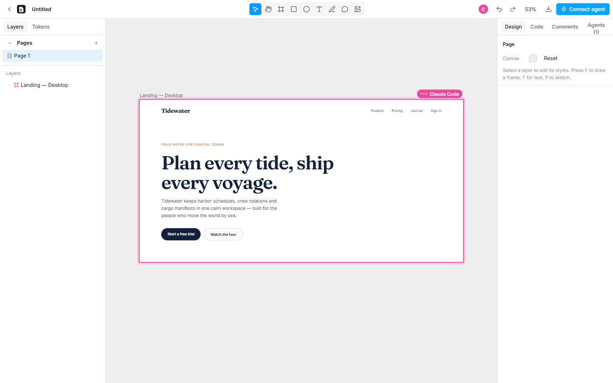
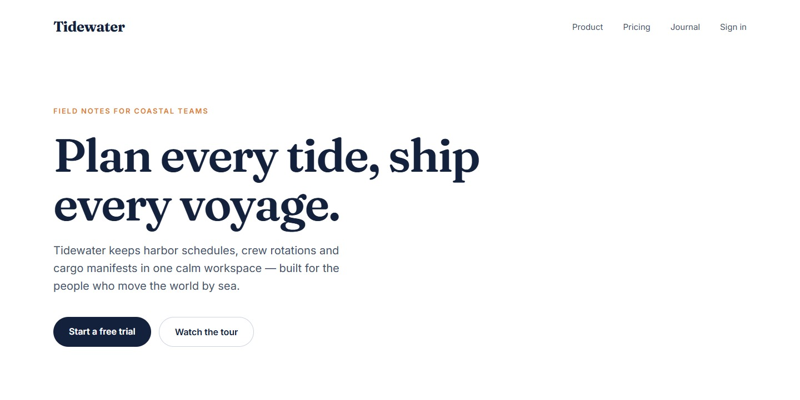

<h1>
  <picture>
    <source media="(prefers-color-scheme: dark)" srcset="docs/brand/logo/openpaper-horizontal-dark.svg">
    
  </picture>
</h1>

**An open-source, AI-first design canvas where every design is real HTML and CSS — with a Paper-compatible MCP server so Claude Code, Cursor, Codex and any MCP client can design alongside you, live.**



OpenPaper is a local-first design tool. You draw frames, shapes, text and freehand sketches on an infinite canvas; AI agents connect over MCP and write HTML straight onto the same canvas while you watch. Because designs *are* HTML/CSS, what you see is exactly what ships: agents can read designs back as JSX/Tailwind and move them into your codebase without translation.

It speaks the same MCP tool set as [Paper](https://paper.design) — all 37 tools, with the same names, parameters and response shapes — so prompts and workflows written for Paper work with OpenPaper unchanged (plus one OpenPaper extension, `update_shader`). Everything runs on your machine; files are plain JSON in `~/.openpaper`.

> OpenPaper is an independent open-source project. It is not affiliated with or endorsed by Paper (Lost Coast Labs, Inc.).

## Features

**Canvas**
- Infinite canvas with pan/zoom; artboards are real DOM rendered with the exact CSS you'll ship
- Tools: Move, Hand, Frame (artboards & frames), Rectangle, Ellipse, Text, Pencil (freehand → SVG), Image, Comment
- Selection that respects depth (click / ⌘-click deep select / double-click to drill in), marquee, resize handles, drag to move or reorder flex children
- Freeform frames (absolute children) or flex layout (column / row / wrap) with gap, padding and alignment
- Layers panel with drag & drop, rename, hide/lock; pages with dividers
- Inspector for size modes (fixed / hug / fill), layout, fills, borders, radius, shadows, typography (all Google Fonts + local fonts) and a raw CSS editor
- Design tokens (CSS variables) used live across the file
- Comments pinned to layers, threads, resolve/reopen
- **Shaders**: 30 live GPU effects — mesh and grain gradients, dithering, noise, metaballs, god rays, liquid metal, halftone and other image filters — as layers with presets and full controls (`S`)
- **Paste from Figma**: copy layers in Figma and paste them onto the canvas as editable frames, text, shapes and vectors (auto layout, components, gradients, effects and images included)
- Copy/paste as clean HTML (paste HTML from any AI chat straight onto the canvas), drag-and-drop images
- Export PNG / JPG / WebP / SVG / PDF; live JSX & Tailwind code panel
- Undo/redo per person — agent changes never pollute your history, and you can undo an agent's last change from the Agents panel

**AI / MCP**
- Built-in design agent: type *"Ask AI to design…"* at the bottom of the canvas and Claude designs on the canvas while you watch (bring your own Anthropic API key)
- Paper-compatible MCP server: Streamable HTTP at `http://127.0.0.1:29880/mcp` **and** stdio via `openpaper mcp` (auto-starts the app)
- Agents see the canvas: `get_screenshot` renders through headless Chrome/Edge — pixel-identical to the editor
- `get_jsx` uses Tailwind CSS v4's own canonicalizer for idiomatic utility classes
- Live presence: working indicators on the artboards an agent touches, write/edit highlights, an activity feed of every tool call
- Live build preview: you watch an agent's work being built. New layers outline and fill in, in tree order, text types in, style changes tween, deletions fade, and a cursor follows where the agent is writing. Only the playback is animated: tool calls still apply instantly, and reduced motion is respected
- Built-in guides (`get_guide`) that teach agents to design incrementally, review their work and use tokens
- `paper-gen://` image generation with your own OpenAI or Gemini key
- Agents can create and tune shader layers too (`<x-shader>` in `write_html`, `update_shader`, the `shaders` guide)
- One-click setup for Claude Code, Claude Desktop, Cursor, VS Code, Codex, Windsurf, Gemini CLI, Antigravity, OpenCode and GitHub Copilot CLI

## Quick start

Requirements: **Node.js 20.19+** (22 recommended) and, for screenshots/exports, any Chromium browser (Chrome, Edge, Brave or Chromium — Edge ships with Windows).

```bash
git clone https://github.com/arshit09/OpenPaper.git && cd OpenPaper
npm install
npm run build
npm start            # starts the server in the background and opens the editor
```

The editor runs at **http://127.0.0.1:29880**. To put the `openpaper` command on your PATH:

```bash
npm link --workspace openpaper     # then: openpaper start | status | stop | doctor
```

## Connect your agent

Open **Connect agent** in the editor for one-click setup, or use the CLI:

```bash
openpaper install claude-code       # or: cursor, vscode, codex, claude-desktop, windsurf,
                                    #     gemini-cli, antigravity, opencode, copilot-cli, --all
```

Manual setup — any MCP client, stdio:

```json
{
  "mcpServers": {
    "openpaper": { "command": "node", "args": ["/absolute/path/to/openpaper/packages/server/dist/cli.js", "mcp"] }
  }
}
```

Claude Code in one line:

```bash
claude mcp add openpaper --scope user -- node /absolute/path/to/openpaper/packages/server/dist/cli.js mcp
```

Or point an HTTP-capable client at `http://127.0.0.1:29880/mcp` while OpenPaper is running.

Then try:

- *"Create a pricing page for a note-taking app in OpenPaper."*
- *"Make three different directions for the hero section of the selected artboard."*
- *"Turn the selected card into a React component in src/components using Tailwind."*
- *"Create a color and spacing token set, then restyle the design to use it."*



## Built-in design agent

No agent app needed: open a file and type into **Ask AI to design…** at the bottom of the canvas. The built-in agent is Claude, working with the same 37 tools an external MCP agent gets, so you watch it lay out artboards, check its work with screenshots and refine — and you can stop it at any moment.

- **Credentials:** paste an Anthropic API key into the chat box the first time (stored only in `~/.openpaper/config.json`, owner-only permissions, never sent to the editor), or start the server with `ANTHROPIC_API_KEY` set, or sign in with `ant auth login`. Requests are billed to that account.
- **Context:** every message includes the file, page and selection you're looking at, so *"make the selected card feel more premium"* just works.
- **Settings** (gear icon): model (Claude Opus 5.5 by default, Sonnet 5.5, Haiku 5.5) and effort (`low` … `max`). Token usage for the conversation is shown in the header.
- Agent edits are a separate actor: your own undo history is untouched, and the Agents panel can undo the agent's last change.
- Conversations are per file and live while the server runs; **New chat** starts over.

## MCP tools

| Group | Tools |
|---|---|
| Files & pages | `open_file`, `list_resources`, `create_file`, `rename_resource`, `create_page`, `update_pages`, `arrange_pages` |
| Reading | `get_basic_info`, `get_selection`, `get_node_info`, `get_children`, `get_tree_summary`, `get_screenshot`, `get_jsx`, `get_computed_styles`, `get_fill_image`, `find_nodes`, `get_font_family_info`, `get_guide` |
| Writing | `write_html`, `create_artboard`, `update_styles`, `set_text_content`, `rename_nodes`, `duplicate_nodes`, `move_nodes`, `delete_nodes`, `finish_working_on_nodes` |
| Tokens | `get_tokens`, `create_tokens`, `set_tokens` |
| Comments | `list_comment_threads`, `get_comment_thread`, `list_comment_thread_authors`, `set_comment_thread_status` |
| Export | `export`, `export_combined_pdf` |
| OpenPaper extension | `update_shader` (shader layers; create them with `<x-shader>` in `write_html`) |

Full reference: [docs/mcp-tools.md](docs/mcp-tools.md).

## Shaders

Press `S` (or the blend icon in the toolbar) to open the shader picker: effects, image filters and logo animations, each with live previews. A shader is a layer like any other — size, radius, opacity, borders and its background fill are ordinary CSS — and the inspector adds presets, sliders, colour lists, optional groups (grain, margins, folds…), images and play/pause.

Agents use the same effects:

```html
<x-shader type="MeshGradient" colors="#0b1d51 #725ac1 #f6bd60" speed="0.4" style="width: 1440px; height: 900px"></x-shader>
```

`get_jsx` exports shader layers as [`@paper-design/shaders-react`](https://shaders.paper.design) components with the same parameters, and screenshots/exports render them through headless Chrome. Shaders are powered by Paper Shaders (Apache-2.0) — see [THIRD_PARTY_NOTICES.md](THIRD_PARTY_NOTICES.md).

## Paste from Figma

Select layers in Figma, press `Ctrl/⌘ C`, then `Ctrl/⌘ V` in OpenPaper. Frames, groups, auto layout (direction, gap, padding, alignment, hug/fill sizing, wrap), text (fonts, weights, line height, letter spacing, case, decoration, mixed styles in short text), rectangles, ellipses, vectors, stars and polygons, gradients, strokes, shadows, blurs, opacity, blend modes, rotation and clipping come across as editable OpenPaper layers. Component instances are expanded with their overrides. Pasting onto the canvas keeps the layers' arrangement; pasting into a selected frame adds them inside it.

Figma's clipboard holds references to images, not the images themselves. To bring images over, add a Figma [personal access token](https://help.figma.com/hc/en-us/articles/8085703771159) (read-only file content) when OpenPaper asks — it is stored only in `~/.openpaper/config.json`, or set `FIGMA_TOKEN`. Without one, image fills paste as grey placeholders. Not supported yet: masks, shader-like Figma effects (noise, glass), and variable-font axes.

## Keyboard shortcuts

OpenPaper uses Paper's shortcuts, plus Figma's where Paper has none. `Ctrl` is `⌘` on macOS and `Alt` is `⌥`. In the editor, `Ctrl+Shift+?` or `Ctrl+/` opens the full, searchable list (it is generated from the same registry as the key handling).

**Tools**

| Action | Keys |
|---|---|
| Move / Hand / Frame / Rectangle / Ellipse / Text / Pencil / Comment | `V` / `H` / `F` or `A` / `R` / `O` / `T` / `P` / `C` or `Y` |
| Shaders / pick a color (fills the selection, or copies it) | `S` / `I` |
| Place image | `Ctrl+Shift+K` |
| Pan | hold `Space` and drag, or middle-drag |
| Zoom tool: click to zoom in, `Alt`+click to zoom out, drag to zoom to an area | hold `Z` (or `Ctrl+Space`) |
| Back to Move, then select parent (deselects at the top level) | `Esc` |

**View**

| Action | Keys |
|---|---|
| Zoom in / out | `+` / `-` (or `Ctrl+=` / `Ctrl+-`); `Ctrl`+scroll or pinch |
| Zoom to 100% / fit / selection | `Shift+0` or `Ctrl+0` / `Shift+1` / `Shift+2` |
| Pan with the keyboard (nothing selected, `Shift` = faster) | Arrows |
| Next / previous artboard; next / previous page | `N` / `Shift+N`; `PageDown` / `PageUp` |
| Measure distances: select, then hover another layer | hold `Alt` |
| Show / hide UI; collapse / expand panels | `.` or `Ctrl+\`; `Shift+\` or `Shift+.` |
| Layers / Tokens panel; show / hide comments | `Alt+1` / `Alt+2`; `Shift+C` |
| Keyboard shortcuts | `Ctrl+Shift+?` or `Ctrl+/` |

**Selection**

| Action | Keys |
|---|---|
| Select all / select others | `Ctrl+A` / `Ctrl+Shift+A` |
| Next / previous sibling | `Tab` / `Shift+Tab` |
| Select children (or edit text) / select parent | `Enter` / `Shift+Enter` or `\` |
| Add to selection / select inside frames / one level deeper | `Shift`+click / `Ctrl`+click / double-click |

**Edit**

| Action | Keys |
|---|---|
| Undo / redo | `Ctrl+Z` / `Ctrl+Shift+Z` or `Ctrl+Y` |
| Cut / copy / paste (as HTML; into a selected frame) | `Ctrl+X` / `Ctrl+C` / `Ctrl+V` |
| Paste on top of the selection / paste to replace it | `Ctrl+Shift+V` / `Ctrl+Shift+R` |
| Copy / paste styles | `Ctrl+Alt+C` / `Ctrl+Alt+V` |
| Duplicate | `Ctrl+D`, or `Alt`+drag |
| Delete / rename | `Delete` or `Backspace` / `Ctrl+R` or `F2` |
| Opacity: `1` = 10% … `0` = 100%, two quick digits for an exact value | `0`–`9` |
| Show / hide; lock / unlock; unlock all | `Ctrl+Shift+H`; `Ctrl+Shift+L`; `Ctrl+Shift+Alt+L` |
| Copy as PNG / Tailwind / React | `Ctrl+Shift+C` / `Alt+T` / `Alt+R` |
| Copy a link to the selection; export | `Ctrl+L`; `Ctrl+Shift+E` |
| Back to all files | `Ctrl+Shift+D` |

**Arrange**

| Action | Keys |
|---|---|
| Nudge 1px / 10px (flex children trade places) | Arrows / `Shift`+arrows |
| Resize 1px / 10px | `Ctrl`+arrows / `Ctrl+Shift`+arrows |
| Move along one axis / keep proportions / resize from the center | `Shift`+drag / `Shift`+drag a handle / `Alt`+drag a handle |
| Draw as a square / from the center | `Shift` / `Alt` while drawing |
| Bring forward / send backward | `Ctrl+]` / `Ctrl+[` (or `Ctrl+Alt+↓` / `Ctrl+Alt+↑`) |
| Bring to front / send to back | `]` / `[` (or `Ctrl+Shift+]` / `Ctrl+Shift+[`, `Ctrl+Alt+]` / `Ctrl+Alt+[`) |
| Group / wrap in frame / ungroup | `Ctrl+G` / `Ctrl+Alt+G` or `Shift+F` / `Ctrl+Shift+G` or `Ctrl+Backspace` |
| Add flex layout (wraps when already flex) / remove it | `Shift+A` / `Alt+Shift+A` |
| Align left / right / top / bottom | `Alt+A` / `Alt+D` / `Alt+W` / `Alt+S` |
| Align horizontal / vertical centers | `Alt+H` / `Alt+V` |
| Distribute horizontally / vertically | `Alt+Shift+H` / `Alt+Shift+V` (macOS `⌃⌥H` / `⌃⌥V`) |
| Flip horizontal / vertical | `Shift+H` / `Shift+V` |
| Resize to fit content / fill the parent | `Ctrl+Alt+Shift+R` / `Ctrl+Alt+Shift+F` |
| Clip content; swap fill and border | `Alt+C`; `Shift+X` |

**Text**

| Action | Keys |
|---|---|
| Bold / italic / underline / strikethrough | `Ctrl+B` / `Ctrl+I` / `Ctrl+U` / `Ctrl+Shift+X` |
| Align text left / center / right / justify | `Ctrl+Alt+L` / `Ctrl+Alt+T` / `Ctrl+Alt+R` / `Ctrl+Alt+J` |
| Font size − / + | `Ctrl+Shift+,` / `Ctrl+Shift+.` |
| Font weight − / + | `Ctrl+Alt+,` / `Ctrl+Alt+.` |
| Line height − / + | `Alt+Shift+,` / `Alt+Shift+.` |
| Letter spacing − / + | `Alt+,` / `Alt+.` |

Shortcuts never fire while you type in a field or edit text. A browser keeps a few keys for itself (`Ctrl+W`, `Ctrl+T`, `Ctrl+N`, `Ctrl+Tab`).

## How it works

```
packages/core     Isomorphic document model, HTML→layers importer, JSX/HTML export,
                  render rules, tokens, queries (shared by server and editor)
packages/server   `openpaper` CLI: local server, file storage, live sync (WebSocket),
                  MCP server (Streamable HTTP + stdio relay), headless rendering,
                  Tailwind worker, image generation, built-in Claude agent,
                  agent-harness installers
apps/editor       React canvas editor (served by the server)
```

The server owns every document. Editors and agents send commands; each change becomes a patch broadcast to every open editor, so you see agents work in real time. Agent edits run as their own actor with their own undo history. Rendering rules live in `core`, so headless screenshots, exports and the canvas are identical. See [docs/architecture.md](docs/architecture.md).

**Data:** `~/.openpaper` (override with `OPENPAPER_HOME`) — `files/*.json`, `assets/` (images, content-addressed), `index.json`. Exports go to `~/Downloads/OpenPaper` (`OPENPAPER_EXPORT_DIR`).

**Image generation:** set `OPENAI_API_KEY` and/or `GEMINI_API_KEY` for the server; agents use `paper-gen://` URLs (see `get_guide({topic: "image-generation"})`).

**Browser for rendering:** auto-detected; override with `OPENPAPER_BROWSER=/path/to/chrome`. Without one, screenshots fall back to an open editor tab.

## Development

```bash
npm run dev          # server with live reload (expects the editor on :5173)
npm run dev:editor   # Vite dev server for the editor
npm test             # unit + MCP integration tests (vitest)
npm run typecheck
```

## Compatibility with Paper

OpenPaper was built by studying Paper's publicly shipped desktop app and published MCP configuration (see [docs/reverse-engineering.md](docs/reverse-engineering.md)) and reimplementing the behavior from scratch: same tool names, parameters, ID formats (`1-0`, `p-1-0`, `root_node_…`), response shapes and error messages, so agents behave the same. Differences: OpenPaper is local-only (no accounts, teams, quotas or cloud sync), images can be generated with your own API keys, agents can create and edit shader layers (`<x-shader>`, `update_shader`), and video export is not implemented yet.

## License

[MIT](LICENSE)
