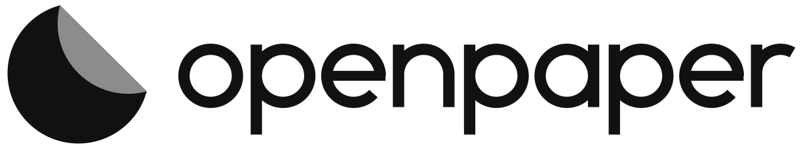

# OpenPaper logo

<picture>
  <source media="(prefers-color-scheme: dark)" srcset="logo/openpaper-horizontal-dark.svg">
  
</picture>

**The idea:** the O of *Open*, peeling up like a sheet of *Paper*. A disc of paper with one edge folded back to show
its other side: open, physical, and a little unfinished, like a design you're still working on.

## Files

All masters are in [`logo/`](logo/) as clean SVG (paths only, no fonts, no effects). PNGs are in [`logo/png/`](logo/png/).

| Use | Light backgrounds | Dark backgrounds |
|---|---|---|
| Primary (horizontal) | `openpaper-horizontal.svg` | `openpaper-horizontal-dark.svg` |
| Stacked | `openpaper-stacked.svg` | `openpaper-stacked-dark.svg` |
| Symbol only | `openpaper-symbol.svg` | `openpaper-symbol-dark.svg` |
| Wordmark only | `openpaper-wordmark.svg` | `openpaper-wordmark-dark.svg` |
| One colour (print, engraving, stamps) | `*-black.svg` | `*-white.svg` |
| App icon / avatar | `openpaper-app-icon.svg` | same |

The editor's favicon set lives in [`apps/editor/public`](../../apps/editor/public): `favicon.svg` (switches to a white
sheet on dark tab bars), `favicon.ico` (16/32/48) and `apple-touch-icon.png`. In the app UI, use the
[`Logo`](../../apps/editor/src/ui/Logo.tsx) component rather than an image: the sheet takes the current text colour, so
it follows the theme.

## Colour

| Name | HEX | RGB | CMYK (approx.) | Pantone (approx.) | Role |
|---|---|---|---|---|---|
| Ink | `#111111` | 17 17 17 | 0 0 0 95 | Black 6 C | The sheet on light backgrounds, the wordmark |
| Fold | `#8C8C8C` | 140 140 140 | 0 0 0 45 | Cool Gray 8 C | The peeled-back side, on every background |
| Paper | `#FFFFFF` | 255 255 255 | 0 0 0 0 | — | The sheet and wordmark on dark backgrounds |

Fold keeps at least 3 : 1 contrast against white, Ink and the editor's dark UI, so the peeled edge stays visible
everywhere. When only one colour is possible, use the one-colour files: they draw the fold with a crease gap instead
of a second colour. Pantone values are approximations; check them against a physical guide before printing.

## Clear space and minimum size

- **Clear space:** keep a quarter of the symbol's diameter free on every side (the depth of the fold). It scales with
  the logo.
- **Minimum size:** symbol 16 px (favicon) / 6 mm; horizontal lockup 100 px / 25 mm wide. Below that, use the symbol.

## Wordmark

`openpaper` is drawn, not typed: a geometric monoline lowercase built from circles and bars, with no font licence
attached. Don't retype it in a font. In running text, write the name as **OpenPaper**.

## Don'ts

- Don't rotate or mirror the mark: the fold always peels at the top right.
- Don't fill the fold with the sheet colour (use the one-colour files), and don't recolour outside the palette.
- Don't add shadows, outlines, gradients or effects, or stretch, squash or rearrange a lockup.
- Don't place it on busy images without the app-icon tile behind it.
